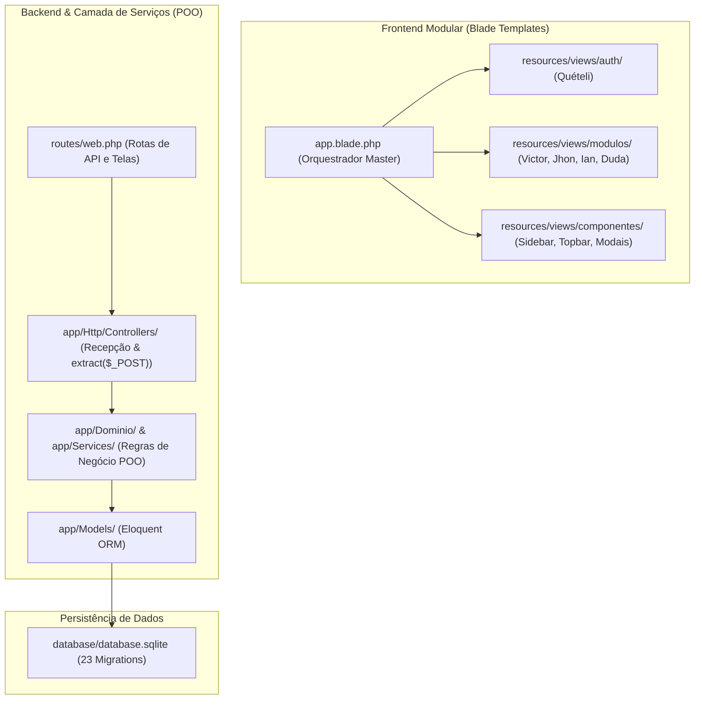

# 🌿 SEIVA — Arquitetura do Sistema e Divisão de Responsabilidades

> **Projeto Interdisciplinar (PI) — Análise e Desenvolvimento de Sistemas (ADS) — IFBA**  
> **Tema:** Dinheiro Sem Tabu · Gestão Financeira Inteligente para Lares Compartilhados e Finanças Pessoais  
> **Entrega:** 2 (Sistema Funcional, POO, Camada de Serviços, Banco de Dados e Documentação)

---

## 1. Visão Geral da Arquitetura

O **SEIVA** foi concebido com uma arquitetura modular, escalável e de fácil manutenção colaborativa. O sistema combina o poder do ecossistema **Laravel 12** com uma camada explícita de **Domínio Orientado a Objetos (POO)** e **Views Modulares Blade**, garantindo que cada membro da equipe possua sua área bem delimitada de atuação.



---

## 2. Estrutura de Diretórios e Organização de Arquivos

Para evitar arquivos dispersos, nomenclaturas genéricas ou conflitos no repositório Git, o projeto segue rigorosamente a seguinte organização:

```
seiva/
├── app/
│   ├── Dominio/                     # Classes de negócio puras em POO com nomenclatura em Português
│   │   ├── ConexaoBanco.php         # Abstração de banco de dados e execução preparada de consultas
│   │   ├── Autenticacao.php         # Regras de autenticação de sessão e credenciais
│   │   ├── ProcessarCadastro.php    # Processamento de novos usuários com extract($_POST)
│   │   ├── Casal.php                # Regras de lares compartilhados e cálculo de rateio proporcional
│   │   └── GerenciarUsuarios.php    # Direitos do titular (LGPD) e criptografia de PIN
│   ├── Http/Controllers/           # Controladores HTTP (validação e orquestração)
│   ├── Models/                      # Modelos Eloquent mapeando tabelas do banco
│   └── Services/                    # Camada de serviços e integração de APIs externas (ex: Google)
│
├── banco-de-dados/                  # Artefatos SQL e diagramas do banco de dados
│   ├── esquema_banco_seiva.sql      # Script SQL de criação e tabelas oficiais
│   └── modelagem/                   # Arquivos de modelagem do MySQL Workbench (.mwb)
│       ├── modelo_workbench.mwb
│       └── backup/
│
├── database/
│   ├── database.sqlite              # Banco de dados local ativo em desenvolvimento
│   └── migrations/                  # 23 migrations versionadas no Laravel
│
├── docs/                            # Documentação acadêmica e técnica oficial
│   ├── academicos/                  # Barema, relato de condução e notas técnicas
│   │   ├── BAREMA_PI_ENTREGA_2.md
│   │   ├── RELATO_DE_CONDUCAO.md
│   │   └── especificacao_requisitos_v2.pdf
│   ├── apresentacoes/               # Slides, apresentações interativas e identidades visuais
│   │   ├── apresentacao_slides_pi.pdf
│   │   ├── apresentacao_interativa.html
│   │   ├── logo_seiva.png
│   │   └── logo_ifba.png
│   ├── diagramas/                   # Diagramas UML e modelos de dados
│   │   ├── diagrama_casos_de_uso.pdf
│   │   ├── diagrama_entidade_relacionamento.pdf
│   │   ├── diagrama_conceitual_bd.pdf
│   │   ├── diagrama_classes.mmd
│   │   └── modelo_fisico_er.mmd
│   └── ARQUITETURA_E_EQUIPES.md     # Este documento mestre
│
├── resources/views/                 # Camada de Apresentação Modular
│   ├── app.blade.php                # Layout orquestrador (inclui módulos e componentes)
│   ├── auth/                        # Telas de entrada e cadastro (Quételi)
│   │   ├── login.blade.php          # Login split screen desktop + hero mobile
│   │   └── onboarding.blade.php     # Cadastro guiado em 4 etapas
│   ├── componentes/                 # Componentes reutilizáveis
│   │   ├── sidebar.blade.php        # Navegação lateral desktop
│   │   ├── topbar.blade.php         # Barra superior e notificações
│   │   ├── bottom-nav.blade.php     # Menu inferior mobile
│   │   ├── fab.blade.php            # Botão de ação rápida (+)
│   │   └── modais/                  # Modais de lançamento e Google Auth
│   └── modulos/                     # Painéis independentes por área de negócio
│       ├── dashboard/painel.blade.php   # RF009 - Dashboard (Victor Hugo)
│       ├── caixa-preta/painel.blade.php # RF002 - Caixa Preta com PIN (Victor Hugo)
│       ├── transacoes/painel.blade.php  # RF003 - Extrato financeiro (Victor / Jhon)
│       ├── lar/painel.blade.php         # RF004, RF010 - Gestão do Lar (Jhon Abner)
│       ├── acordos/painel.blade.php     # RF006 - Mesa de Acordos (Ian Marcos)
│       ├── metas/painel.blade.php       # RF007, RF008 - Metas do Lar (Ian Marcos)
│       ├── cobrador/painel.blade.php    # RF005 - Cobrador Diplomata (Victor Hugo)
│       └── perfil/painel.blade.php      # RF011 - Perfil e LGPD (Maria Eduarda)
│
└── tests/Feature/                   # Testes automatizados (PHPUnit / Pest)
    ├── AuthTest.php
    └── GoogleAuthTest.php
```

---

## 3. Divisão de Responsabilidades da Equipe (Conforme Barema de ADS)

| Integrante | GitHub | Módulos e Requisitos Funcionais | Arquivos Principais |
|---|---|---|---|
| **Victor Hugo** | `@Victorapenas` | **Líder Técnico & Arquitetura Base**<br>• RF002: Caixa Preta com PIN Criptografado<br>• RF005: Cobrador Diplomata com PIX<br>• RF009: Dashboard Consolidado e Contas | `resources/views/modulos/dashboard/`<br>`resources/views/modulos/caixa-preta/`<br>`resources/views/modulos/cobrador/`<br>`app/Dominio/ConexaoBanco.php` |
| **Quételi** | `@Queteli` | **Autenticação, Segurança e Cadastro**<br>• RF001: Autenticação de Usuários<br>• Onboarding em 4 passos com validação de senha<br>• Login nativo e integração com Google API | `resources/views/auth/login.blade.php`<br>`resources/views/auth/onboarding.blade.php`<br>`app/Dominio/Autenticacao.php`<br>`app/Dominio/ProcessarCadastro.php`<br>`app/Services/GoogleAuthService.php` |
| **Jhon Abner** | `@JhonAbner` | **Lares Compartilhados e Finanças Coletivas**<br>• RF004: Gestão do Lar e Moradores<br>• RF010: Rateio Proporcional Justo por Renda<br>• RF003: Lançamento de Despesas Compartilhadas | `resources/views/modulos/lar/`<br>`resources/views/modulos/transacoes/`<br>`app/Dominio/Casal.php`<br>`app/Models/Lar.php` |
| **Ian Marcos** | `@IanMRS` | **Planejamento Financeiro e Consenso**<br>• RF006: Mesa de Acordos e Votação de Compras<br>• RF007: Metas Pessoais e Metas do Lar<br>• RF008: Acompanhamento de Progresso e Depósitos | `resources/views/modulos/acordos/`<br>`resources/views/modulos/metas/`<br>`app/Models/Acordo.php`<br>`app/Models/Meta.php` |
| **Maria Eduarda (Duda)** | `@MaduLima22` | **Documentação Técnica & Privacidade LGPD**<br>• RF011: Perfil, Direitos do Titular (Art. 18 LGPD)<br>• Exportação de dados em JSON e eliminação<br>• Relato de Condução e Documentação Acadêmica | `resources/views/modulos/perfil/`<br>`app/Dominio/GerenciarUsuarios.php`<br>`docs/academicos/RELATO_DE_CONDUCAO.md`<br>`docs/academicos/BAREMA_PI_ENTREGA_2.md` |

---

## 4. Padrões de Código e Diretrizes Didáticas

### 4.1 Programação Orientada a Objetos (POO)
Toda funcionalidade de regra de negócio é modelada com princípios de POO:
- **Encapsulamento:** Propriedades privadas/protegidas com métodos acessores (`getters`/`setters`).
- **Abstração e Polimorfismo:** Classes de serviço implementando interfaces (ex: `AuthServiceInterface`, `BaseAuthService`).
- **Nomenclatura em Português:** Classes de domínio em `app/Dominio/` nomeadas de acordo com os termos de negócio ensinados em aula (`ConexaoBanco`, `Autenticacao`, `Casal`, `GerenciarUsuarios`, `ProcessarCadastro`).

### 4.2 Recepção de Formulários com `extract($_POST, EXTR_SKIP);`
Para satisfazer a metodologia exigida pelo professor em sala de aula, os métodos de recebimento de formulários nos controladores adotam a extração:
```php
if (!empty($request->all())) {
    $_POST = array_merge($_POST, $request->all());
}
extract($_POST, EXTR_SKIP);
```
O uso da flag `EXTR_SKIP` garante que variáveis internas pré-existentes não sejam sobrescritas, preservando a segurança sem perder a didática acadêmica.

### 4.3 Isolamento em Módulos Blade
Nenhum integrante deve editar o arquivo central sem necessidade. Ao trabalhar na sua funcionalidade:
- Edite **apenas** o arquivo do seu módulo em `resources/views/modulos/<seu-modulo>/painel.blade.php`.
- O arquivo `resources/views/app.blade.php` atua apenas como integrador com `@include(...)`.

---

## 5. Como Executar o Projeto Localmente

O SEIVA roda de forma autônoma sem necessitar de Apache ou MySQL externos do XAMPP:

```powershell
# 1. Navegue até a pasta do projeto
cd c:\Users\zenin\dev\pessoal\seiva

# 2. Inicie o servidor PHP embutido do Laravel
& "C:\xampp\php\php.exe" artisan serve --port=8000

# 3. Acesse no navegador:
# http://localhost:8000
```

Para rodar os testes automatizados da aplicação:
```powershell
& "C:\xampp\php\php.exe" artisan test
```
